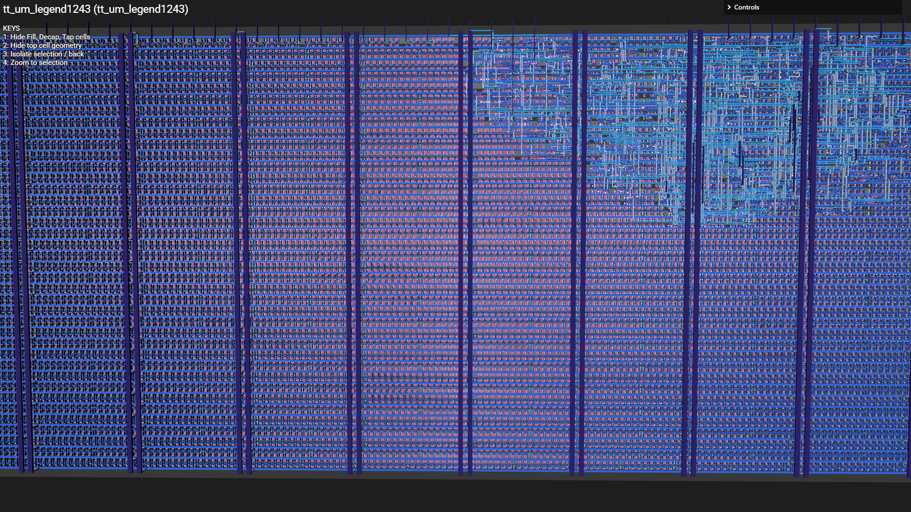

   

# C404 — 4-bit CPU

- [Read the documentation for project](docs/info.md)

## What is Tiny Tapeout?

Tiny Tapeout is an educational project that aims to make it easier and cheaper than ever to get your digital and analog designs manufactured on a real chip.
To learn more and get started, visit https://tinytapeout.com.

## Enable GitHub actions to build the results page

- [Enabling GitHub Pages](https://tinytapeout.com/faq/#my-github-action-is-failing-on-the-pages-part)

## Resources

- [FAQ](https://tinytapeout.com/faq/)
- [Digital design lessons](https://tinytapeout.com/digital_design/)
- [Learn how semiconductors work](https://tinytapeout.com/siliwiz/)
- [Join the community](https://tinytapeout.com/discord)
- [Build your design locally](https://www.tinytapeout.com/guides/local-hardening/)

## Project Status

C404 has completed its initial RTL implementation and functional verification.
The project includes:
1. A 4-bit CPU implemented in Verilog.
2. Instruction decoding and execution.
3. Arithmetic and logical operations.
4. Register and carry flag management.
5. Functional testing using Cocotb.
The project is being prepared for submission to Tiny Tapeout.
