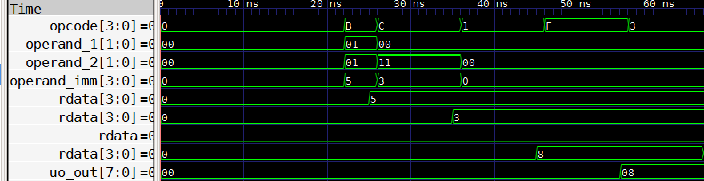

# C404 — 4-bit CPU inspired by Intel 4004

# introduction

## Why did I made this CPU?
A few years ago, I was introduced to the concept of transistors in my physics class, learning about NPN and PNP transistors. Around the same time, I came across two videos in my YouTube feed that completely changed how I saw computers: Building an 8-bit Breadboard Computer! by Ben Eater and Exploring How Computers Work by Sebastian Lague. These videos planted an idea in both me and my friend: what if we could build a CPU from scratch, starting all the way from transistors and eventually making our own silicon?

Since then, building a CPU has been a long-standing goal of mine. I was also fascinated by the Intel 4004, the world's first commercially available microprocessor. It was a 4-bit processor running at around 740 kHz, yet it was capable of performing the fundamental operations that made modern computing possible. That made me want to build something of my own, even if it was much simpler.

I had been sketching different CPU architectures for a while, but I only started implementing C404 in Verilog after discovering the Hack Club ASIC program. What started as a long-time dream suddenly became a project I could actually manufacture on silicon.

## inspirations from Intel 4004
The name C404 comes from the initial of my name and the Intel 4004. The Intel 4004 was also a major inspiration for the overall direction of the project. I initially considered building something more ambitious, with separate ROM and RAM, an 8-bit memory address space, and several registers. However, combining an 8-bit memory addressing scheme with a 4-bit CPU introduced many awkward design complications. I also realised that fitting both an SPI interface and the CPU into a single Tiny Tapeout tile would be impractical. Eventually, I decided to simplify the architecture and focus on the CPU itself.

I also took some inspiration from the x86 architecture, particularly its register naming conventions. This influenced the design of C404's registers, which eventually became A, B, and Z. Z has a dedicated role as the destination register for ALU operations. This makes it possible to keep the source operands separate from the result, giving the CPU a more structured way of handling instructions.

## Project Constraints
This project was developed in under a week. I had only recently discovered the Hack Club ASIC program when I saw it featured on the main page. Last Sunday, I completed the final specification draft for C404. Note that this was the specification, not the actual RTL implementation.

Since I had no idea how many gates the design would eventually require, I decided to further simplify the architecture during RTL implementation whenever necessary. The final design ended up using 236 cells, as reported by GitHub's LibreLane flow.

# Architecture and design
specs can be found in [documentation/info.md](info.md)

## Years of daydreaming
Before starting this project, I had already taught myself the basics of CPU architecture, including registers, pipelining, and out-of-order execution. I had been sketching designs for C404 and other CPUs for years.

My earlier designs were considerably more ambitious, and, looking back, some of their ideas were not particularly practical. As I learned more about computer architecture, I gradually realised that less is more. What's the point of designing something ambitious if it is ultimately impossible to implement within the available constraints?

## final draft
Last Sunday, I dug up my old sketches and started simplifying the architecture. One of the biggest problems was the combination of a 4-bit CPU with an 8-bit memory address space. Handling 8-bit addresses introduced unnecessary complications for such a small processor. On top of that, having a mere 16-word ROM and RAM made the memory architecture difficult to justify. I also could not fit both an SPI interface and the CPU into a single Tiny Tapeout tile.

Eventually, I decided to remove the memory architecture altogether. C404 would focus entirely on arithmetic and logic operations, keeping the design as small and straightforward as possible.

Some might argue that C404 is now merely a mathematical coprocessor, and I do agree to some extent. However, its original design included branching and memory operations. The project evolved from that original CPU concept, so I still consider it a CPU, even if its final implementation is much more limited.

The final specification draft still had a few things that would change during implementation. It included a SYNC clock input because I initially expected instructions to take multiple clock cycles to execute. It also only defined 14 instructions, leaving two instruction slots unused.

## modifications during RTL
During RTL implementation, I realised that the instructions did not actually require multiple clock cycles to execute. As a result, I removed the SYNC clock input and simplified the execution process.

I also filled the two remaining instruction slots by adding SUBC and CMP, bringing the instruction set to its final total of 16 instructions.

# Journey of the RTL Implementation

## installation and configuration
For almost every project, the part I dread the most is inevitably installing new software.

I still have some PTSD from trying to set up C# for Sebastian Lague's TinyChessChallenge. That experience took me almost a month, mostly because I had no idea how to edit environment variables and configure the PATH properly.

Fortunately, setting up Icarus Verilog, GTKWave, and OSS CAD Suite went much more smoothly this time. I installed Icarus Verilog and GTKWave separately inside my MinGW64 environment because I found OSS CAD Suite somewhat inconvenient to work with, particularly because of its environment setup requirements.

## learning verilog in 1 day
To finish this project on time, I had to learn Verilog in roughly a day and complete the implementation within a week.

Surprisingly, Verilog was much simpler than I had expected. In fact, I found it easier to work with than some of my ongoing programming projects, such as a chess engine and a custom programming language (both of which are private projects).

The syntax felt rather unusual at first, especially compared with conventional programming languages. However, once I became familiar with it, the language was quite straightforward.

Coming from a software programming background, I found that translating familiar programming concepts into Verilog was not particularly difficult. A Verilog module is somewhat similar to a function or class in a conventional programming language: it has inputs and outputs and can encapsulate a particular piece of functionality. Similarly, wires and registers can initially be understood as variables, although they have important differences in how they behave and how hardware is inferred.

The biggest difference is that Verilog describes hardware rather than simply giving a computer a sequence of instructions to execute. Once I understood that distinction, the rest of the language became much easier to grasp.

## the actual RTL

I splitted the design into multiple modules: TOP/main, decode, registers, carry flag, control_alu, shared_adder and output, so that its far more manageable.

- top module: act as the glue between all these modules.
- decode module: fetch the input pins and decode them into opcode and operands.
- registers module: store register values, deal with input and output,and with safety enable wires.
- carry flag module: I directly copied it from registers module, with some minor changes
- control alu module: initially I was going to separate into control and alu, but after further thought, combining them would simplify the design. It is the main brain of the entire cpu, doing both executing instructions and storing them into register Z.
- shared adder module: an attempt to save die area from having separate adders for different arithmetic instructions, but actually unnecessary(I only ultilised 10% routing and 236 cells)
- output: executes OUT instruction which is outputting data from register Z to outpins with a latch.

# Instruction execution walkthrough

## example code
### here are some example code that i used for testing
LDI_A 5  - load 5 into register A;
LDI_B 3  - load 3 into register B;
ADD  - Add A and B and store in Z;
OUT - output result from Z;

### the waveform diagram

|each component|description|  
|:------------------|-------------|
|opcode|instruction opcode from input |
|operand 1| instruction operand 1 from input|
|operand 2| instruction operand 1 from input|
|operand imm| instruction operand imm from input|
|1st rdata| register A|
|2nd rdata| register B|
|3rd rdata| carry flag|
|4th rdata| register Z|
|ui_out|output pins|

After reset pin is low and during first clock cycle, CPU received the instruction, LDI_A and register A is set to 5.  
On the next turn, LDI_B is received and register B is set to 3.
Then add instruction is executed, register Z is set to A+B(5+3) = 8.
Carry flag is not triggered as there is no integer overflow.  
Output is sent to out_pins.  

# Conclusion

Looking back, C404 turns out to be a much more achievable project than I initially expected. What started as an idea I had been day dreaming about for years eventually became a working 4-bit CPU design, implemented in Verilog and taken through the ASIC design flow in less than a week.

Throughout this project, I learned a lot about RTL design, hardware architecture, simulation, and synthesis. One of my biggest takeaways is that a simpler design is not necessarily a worse design. My original architecture was much more ambitious, but simplifying it allowed me to actually finish the project within the available time and hardware constraints. I also learned that hardware optimisation needs to be considered carefully. For example, I spent time implementing a shared adder to reduce area, only to realise that the available tile area was not nearly as restrictive as I had expected.

Of course, C404 is far from a complete general-purpose CPU. It lacks memory, branching, and many other features found in conventional processors. However, that is something I would like to explore in my next project.

## What's Next?

My next goal is to design an 8-bit CPU inspired by both Intel 8080 and AVR. Unlike C404, I want this processor to have a proper memory architecture, branching instructions, and a more complete instruction set. I also want to take what I learned from C404 and apply it to a more ambitious design, while keeping the architecture practical enough to implement.

For now, C404 is a small but meaningful first step towards a much bigger goal: designing my own CPU and eventually building more complex processors on silicon.